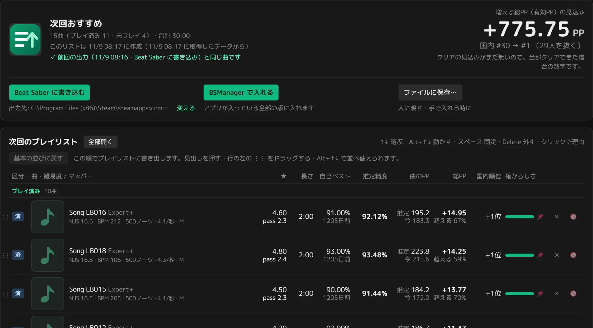
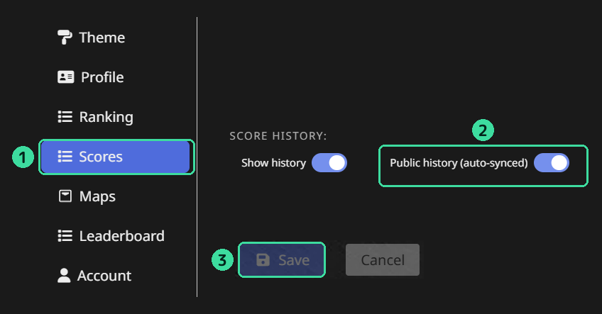

# blnext — BeatLeader 次回プレイリスト生成ツール

BeatLeader の公開データから「次に遊ぶと総PP（有効PP）が伸びそうな曲」を選んで、Beat Saber のプレイリストにする Windows 用のアプリです。

*A Windows app that picks the ranked maps most likely to raise your BeatLeader PP next session and turns them into a Beat Saber playlist. The UI is Japanese only for now.*



## できること

- **次に遊ぶ曲のおすすめ**: 曲ごとに、次に遊んだ日に出せそうな精度（推定精度）・増える総PP の見込み・その日にクリアできる見込みを出し、総PP が伸びやすい曲を選びます。推定には、自分の記録と、国内順位の近い人の記録を使います。
- **難しさ違いのセット**: 着実・標準・チャレンジングなど、条件の違うリストをいくつも持てます。★の範囲・曲数・難しさはセットごとに変えられます。
- **ゲームに入れる**: Beat Saber のフォルダに書き込む・BSManager のワンクリック・.bplist のファイルに保存、の 3 通り。
- **振り返り**: 遊んだ後に開くと、前回のリストの曲ごとの推定と結果、増えた総PP、伸ばした曲（曲の PP と総PP の増え）、抜いた人・抜かれた人を見られます。
- **続けて同じ曲を出さない**: 遊んだ日を数えて、続けて遊んだ曲やクリアできない日が続いた曲をしばらく休ませます。
- **アプリの中から更新**: 新しい版があれば知らせ、そのまま更新できます。

## 始め方

1. [Releases](https://github.com/Oz-Co-two/blnext/releases) から `blnext-<版>.zip` をダウンロードし、好きな場所に展開します（Program Files の中など、書き込めない場所は避けてください）。
2. `blnext.exe` を起動します。「Windows によって PC が保護されました」と出たら、「詳細情報」→「実行」を押してください（個人が作ったアプリで、コード署名をしていないためです）。
3. 「はじめに」の画面で、BeatLeader の表示名か ID を入れて自分を選びます（ログインは要りません）。1 分ほどでデータを取り、難しさ違いの 3 つのプレイリスト（10 曲ずつ）ができます。
4. ゲームに入れて遊び、遊んだ後にアプリを開いて結果を確かめます。

遊び方の流れと各画面の見方は、アプリの上の「使い方」にあります。

### 必要な物

- Windows 11（画面に Microsoft Edge WebView2 を使います。Windows 11 には入っています）
- ゲームの中でプレイリストを読むための Mod「PlaylistManager」
- BeatLeader のアカウントと、ランク曲のスコア

## BeatLeader の統計を公開にする（おすすめ）

BeatLeader の統計が非公開だと、失敗や途中でやめた挑戦の記録を読めないので、クリアの見込みと、続けて同じ曲を出さない働きが効きません。

1. [beatleader.com](https://beatleader.com/settings#scores) にログインし、右上の Settings を開いて、左の「Scores」を選ぶ
2. 「SCORE HISTORY」の「Public history (auto-synced)」をオンにする（左の Show history ではありません）
3. 画面の一番下の「Save」を押す



無料で変えられ、過去の分も読めるようになります。オンにすると、挑戦の回数や失敗した記録、遊んだ日時をほかの人も見られるようになります。順位や PP は変わりません。いつでも戻せます。

## 通信とデータ

- 通信するのは BeatLeader（公開 API にプレイヤーの ID を送ります。自己ベストのリプレイの先頭も読みます）・BeatSaver の CDN（曲の画像）・jsDelivr（ランク譜面の変化を確かめる公開のファイル）・GitHub（新しい版の確認と更新のダウンロード）だけです。あなたのデータをどこかへ送ることはしません。
- BeatLeader への問い合わせは、BeatLeader の回数の上限より十分少なくしています。前回の取得から 12 時間（設定で変えられます）たっていなければ、起動しても自動では取りません。
- 設定と取得したデータは、`blnext.exe` の隣の `config`・`data`・`logs`・`exports` に置きます。インストーラーはありません。消す時はフォルダごと消してください。

## 困った時・不具合の報告

- 設定 →「このアプリについて」→「不具合を報告」で、版と Windows の版を入れた [Issues](https://github.com/Oz-Co-two/blnext/issues) のページが開きます。
- 起動しない時は、ダウンロードした zip を右クリック →「プロパティ」→「許可する」にチェックしてから展開し直してください（インターネットから来たファイルの印で、部品を読み込めないことがあります）。
- 同じ所の「ログのフォルダを開く」で開くフォルダのファイルを添えてもらえると、原因を調べやすくなります。ログには BeatLeader に問い合わせた URL（プレイヤー ID）と、失敗した時はアプリのフォルダの場所が入ることがあります。

## 開発

Python 3.14 と pywebview（WebView2）。画面は HTML・CSS・素の ES Modules で、Node.js やビルドの道具は使いません。

```
py -3.14 -m venv .venv-build
.venv-build\Scripts\pip install pywebview numpy pyinstaller pytest pytest-cov pillow

.venv-build\Scripts\python.exe serve.py              # 画面をブラウザで開いて確かめる
.venv-build\Scripts\python.exe app.py                # デスクトップのアプリとして起動する
.venv-build\Scripts\python.exe tools\run_tests.py    # テスト（単体・画面の操作・画面の比較。ヘッドレスの Edge を使う）
```

- 仕様は [`docs/spec.md`](docs/spec.md)、実装の前に調べたことは [`docs/investigation.md`](docs/investigation.md)、テストの使い方は [`tests/README.md`](tests/README.md)、開発の約束は [`CLAUDE.md`](CLAUDE.md)。
- 本体は `core/`（取得 → 保存 → 推定 → 出力）、ローカルサーバーは `serve.py`、画面は `web/`。
- PP の計算は BeatLeader の式（PPv4.1）の移植です（`core/estimate/ppcalc.py`）。

## ライセンス

[GNU General Public License v3](LICENSE)。保証はありません。使っている部品は [`THIRD_PARTY_NOTICES.txt`](THIRD_PARTY_NOTICES.txt) にあります。
アプリの骨組みは [NLM（Non-Linear Mapper Oz-Co2 版）](https://github.com/Oz-Co-two/nlm-oz-co2) から流用しました。

BeatLeader・Beat Saber の公式のアプリではありません。
