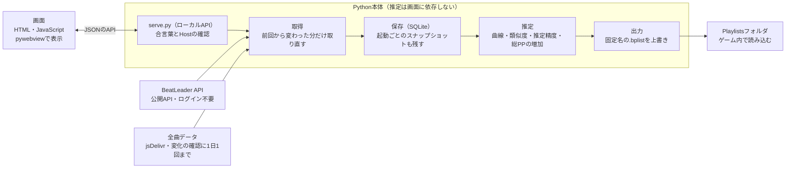

# BeatLeader 次回プレイリスト生成ツール 仕様書

Oct 14, 2026 · @アズサ

## 目的と前提

BeatLeaderの国内順位を上げるために、「次のプレイ日にやると点が稼げる曲」を10〜15曲選び、Beat Saberのプレイリストとして出力するデスクトップアプリを作る。

- **目標**：最初の利用者（BeatLeaderのプレイヤー名 Oz-Co2）の国内順位500位。目標順位は設定で変えられる。
- **使い方の前提**：プレイは週3日程度。プレイした翌日か、次のプレイ日の前に起動し、その時点の最新の順位をもとにリストを作る。
- **解きたい問題**：周辺の順位の人の高得点曲をそのまま集めると、得意不得意が合わず点が取れない曲が混ざる。プレイスタイルが近い人の結果を使い、自分が取れそうな曲を選ぶ。
- **形態**：まず自分のPC（Beat Saberが入っているWindows PC）で動くアプリ。Webアプリにはしない。起動時に、前回の取得から一定の時間（初期値12時間）以上たっていれば最新情報を取りに行く。
- **将来**：公開（配布）を想定し、プレイヤーID・国・目標順位は設定で変えられるようにしておく。
- **過去のデータ**：最新の状態で比較できれば基本は十分。遡れる範囲は取り込み、それ以降は起動するたびに記録を溜める。
- **作らないもの**：リプレイ分析、リーダーボードの閲覧、プロフィール表示はBeatLeader本体に任せる。

## 利用の流れ

1回の利用は、起動してから出力まで数分で終わる流れにする。

0. **初回の準備**（最初の1回だけ）：小さな画面で BeatLeader の表示名か ID を入れて自分を選ぶ（国と目標順位もその人に合わせる）→ データを取得（1分ほど）→ 難しさ違い（着実・標準・チャレンジング）の10曲ずつのリストができ、そのままゲームに入れられる。途中で閉じても次に開いた時に続きから。
1. **起動・自動更新**：前回の取得から設定の時間（初期値12時間）以上たっていれば、BeatLeaderから最新データを取りに行く。それより近ければ取りに行かず、画面の上の「更新」を押した時だけ取る（開き直すたびに通信しないため）。進捗を表示し、前回から順位やPPが動いたプレイヤーだけ取り直す。
2. **ホーム画面**：今の国内順位とPP、目標順位までのPP差、上下10人とのPP差、前回起動からの変化（自分が更新した曲、周辺の順位の動き）を表示する。
3. **おすすめ画面**：次回用の候補を理由付きで表示する（今やり直したら取れそうな精度、増えるPP、上がる国内順位、参考にした似ている人）。リストは作った時のまま残し、データを取り直しても勝手には変えない（前に作ったリストがなぜ選ばれたのかを、次のプレイまでの間に見直せるように）。今のデータで作り直すと変わる時は、入る・外れる曲を知らせ、利用者が「作り直す」を押した時だけ入れ替える。
4. **調整**：候補を外す・固定する・入れ替える。曲数や比率などの設定を変えると、その場で再計算する（利用者の操作なので、この時は今のデータで作り直す）。
5. **出力**：Beat SaberのPlaylistsフォルダへ.bplistを書き込む（ほかに、BSManagerなどのワンクリックで入れる・ファイルに保存する、も選べる）。毎回同じファイルを上書きするので、ゲーム内には常に「次回おすすめ」が1つだけある状態になる。設定のセット（例：スタンダード用・ワンセイバー用）ごとに、別のおすすめとプレイリストを作れる。
6. **振り返り**：次に起動したとき、前回出力した曲の結果（伸びた・伸びなかった）を記録し、次のおすすめに反映する。

## システム構成と技術

NLM（[Non-Linear Mapper Oz-Co2版](https://github.com/Oz-Co-two/nlm-oz-co2)）と同じ構成で作り、アプリの骨組みはNLMから流用する。計算はPython、画面はHTMLとJavaScriptで書き、pywebviewでWindowsのウィンドウとして表示する。

画面はJSONのAPIで `serve.py` とだけやり取りし、データは取得→保存→推定→出力の順に流れる。推定は画面にもpywebviewにも依存させない。

全体の構成（Mermaid）。



| 項目 | 内容 |
| --- | --- |
| 言語 | Python 3.14（開発用venvは `.venv-build`）。画面はHTML・CSS・素のES Modules（Node/npm・ビルドツールは使わない） |
| 画面 | pywebview＋WebView2のネイティブウィンドウ。`app.py` がローカルサーバーを空きポートで起動して表示する |
| ローカルサーバー | `serve.py`：静的ファイルとローカル専用のAPI（`/__api/*`）。開発中は `python serve.py` でブラウザから確認する |
| 計算 | Python（標準ライブラリ＋numpy）。曲線近似・類似度・PP計算 |
| 保存 | SQLite（exe隣の `data/`）と設定JSON（exe隣の `config/`） |
| 配布 | PyInstallerのonedir（exe＋`_internal/`）をZIPで配布。アプリ内から更新できる |
| ライセンス | GPLv3（NLMのコードを流用するため） |

**NLMから流用するもの**

- `app.py`：pywebviewの起動、`_data_root()`（exe隣のユーザーデータの場所）、`_unblock_dist_folder()`（ダウンロードしたZIPで起動に失敗する問題の対策）、`_app_version()`、閉じるときの処理（`events.closing`）
- `serve.py`：Hostヘッダーの確認、POSTの `X-NLM-Request` ヘッダー必須、起動ごとの合言葉（`SESSION_TOKEN`／`X-NLM-Token`、URLの `#k=` で画面へ渡す）、`_reply()`／`_drain()`、`translate_path` の制限、`PUBLIC_FILES`／`PUBLIC_DIRS`。ヘッダー名・環境変数の接頭辞（`NLM_`）は新しいアプリ用に改名する
- アプリ内更新：`app_update.py`、`/__update/*`、`js/update/update-dialog.js`、`tools/make_release.py`（GitHubのリリースに添付したupdate.jsonのSHA-256で照合、前の版を `_previous_<版>` に残す、`_env_for_child()`）。
  作る時は、外のアプリ（ブラウザ・BSManager など）が `_internal` の DLL をつかんでいても止まらないようにする（2026-10-17 に調べた。`docs/investigation.md` の「使用中のファイルと自動更新」）:
  ① 外を起動する時は `core/launch.py` を通す（済）。② 差し替えは削除ではなく名前の変更で退避し、退避した古い版の削除は失敗してよく、次に起動した時にやり直す。
  ③ それでも失敗した時は、Restart Manager で使っているアプリの名前を出して「閉じてからもう一度」と案内する。更新の補助として起動する exe も `core/launch.py` と同じく探し先を引き継がせない
- 設定の保存：書き終えてから置き換える方式と、「キーが無い＝初期値」で動かす約束
- 表示言語の仕組み（`lang/ja.json`・`lang/en.json`、`t()`、`data-i18n`）。最初は日本語だけでもよいが枠は用意する
- 画面の安全対策：CSP（インラインscriptとHTML属性のハンドラを禁止）、外から来た文字列は `escHtml()` を通す
- テストと確認の道具：`tools/run_tests.py`、`tools/cdp.py`（ヘッドレスEdgeで画面を確認）
- `nlm.spec`：新しい .py を足したら datas と hiddenimports に足す約束も引き継ぐ

**流用しないもの**：エディタ本体（`editor-app.js`）、3Dプレビュー、譜面チェック、ffmpeg関連、File System Access API関連。PlayerData.datの読み込み（`media_library.py`）は、最初は流用する予定だったが作っていない。全曲データ（`song_details.py`）は取得と読み取りの考え方だけ流用した（`core/fetch/song_details.py`）。

**Python側の分け方**：取得（BeatLeader・全曲データ）、保存（SQLite）、推定（おすすめの計算）、出力（.bplist）の4つに分け、画面とはJSONのAPIだけでやり取りする。推定はpywebviewにも画面にも依存させない。後でコマンドライン版やWeb版を作るとき、推定をそのまま使えるようにするため。

## データ取得

起動した時（前回の取得から設定の時間 `auto_refresh_hours` 以上たっている時だけ）と「更新」を押した時に、BeatLeaderの公開API（`https://api.beatleader.com`、ログイン不要）から取得し、すべてローカルDBに保存する。2回目以降は、変化した分だけ取り直す。下の表の「毎回」は、この取得の回ごとのこと。

| 何を | どこから | 使い方 | いつ |
| --- | --- | --- | --- |
| 自分のプロフィール | `GET /player/{id}?stats=true` | PP、世界順位、国内順位、acc・pass・tech別のPP、先週の値 | 毎回 |
| 国内ランキング | `GET /players?countries=jp&sortBy=pp&count=100&page=N` | 自分の国内順位から、上100人・下100人が入るページだけ取る（1回100人まで）。各人のPP・順位・acc・pass・tech別PP・最終ランクスコア時刻 | 毎回 |
| 自分のスコア | `GET /player/{id}/scores?type=ranked&sortBy=date&order=desc&count=100&page=N` | 初回は全件。2回目からは最近挑戦した順（`sortBy=lastTryTime`）で、前回より前の挑戦が出るまで取る（統計が非公開の人は投稿日時の順）。精度、PP、FCしていた場合の精度とPP、重み、acc・pass・tech別PP、譜面の★・各レーティング・予測精度（predictedAcc）・譜面タイプ。プレイ回数と最終挑戦日時は統計を公開している人だけ入る | 毎回 |
| 比較対象のスコア | `GET /player/{id}/accgraph?type=acc` | ランク曲の全スコアを1回で取る（★、精度、PP、acc・pass・techレーティング、日時、モディファイア） | 最終ランクスコア時刻が前回から変わった人だけ |
| 日々の履歴 | `GET /player/{id}/history/compact?count=N` | 順位・PP・国内順位の推移。自分は初回に取れるだけ遡る | 毎回（自分）、表示に必要な分だけ（周辺） |
| ランク譜面の一覧 | `GET /maps?type=ranked&count=500&page=N` | 未プレイ曲の候補。★・各レーティング・予測精度・アップロード日（古い譜面のフィルタ） | 初回と、下の全曲データで変化が分かった時。変化が無くても30日に1回。設定のボタンでも取れる |
| 全曲データ | jsDelivrの `songDetails2_v3.gz`（kinsi55 さんの BeatSaberScrappedData） | ランク譜面の★と手元の★を比べて、変化があるかを確かめるだけ（レーティングが無いので一覧の代わりにはならない）。多くの譜面の★が変わっていたらリウェイトとして全部取り直す | 1日1回まで、ETag付き |
| 挑戦の記録（アテンプト。1回ごとの記録） | `GET /player/{id}/scoresstats?type=ranked&sortBy=date&order=desc&count=100&page=N&time_from=…` | 統計を公開している人だけ。直近1年分。クリアの見込み・クールダウン・伸び悩み・振り返りなどに使う | 毎回（前回より後の分） |

PC内の記録（PlayerData.dat・リプレイのファイル）は読まない。

**差分更新**

- 比較対象は、国内順位で自分の上100人と下100人を候補にして、その中からランクのスコアの多い順に50人（どの人数も設定で変更。根拠は 作者の調べ「比較対象の人数」）。
- プレイヤーごとに、前回取得したときのPPと最終ランクスコア時刻をDBに持つ。ランキングの結果と比べて変わった人だけ、スコアを取り直す。
- ランキングで分かるランクのスコアの数が「曲線を作る最低スコア数」（`min_scores`。全部のセットの一番小さい値）より少ない人は、取っても使わないので取らない。増えて届いた時・設定を下げた時は次の取得で取る。
- 範囲から外れた人のデータは消さずに残す（範囲に戻ってきたときに差分だけで済むように）。

**アクセス量の約束**

- 同時接続は2本まで、1秒あたり5回までに抑える（BeatLeaderの制限値は未確認のため控えめにする）。
- 全曲データ（jsDelivr）は BeatLeader とは別のサーバーなので、BeatLeader の取得と並べて取る（取得の時間を短くするため。BeatLeader への要求の数・間隔は変えない）。
- 失敗したら、待ち時間を伸ばしながら3回まで再試行する。429（回数制限）を受けたら、指示された時間だけ待つ。
- User-Agentにアプリ名と版を入れる。
- 初回は最大50人分の取得になる。進捗を「○人中○人」で表示し、途中で閉じても取得済みの分は保存されるようにする。

## データ保存

exe隣の `data/` にSQLiteのDBを1つ置き、取得したデータ・計算結果・出力の記録をすべて入れる。起動ごとのスナップショットを残すので、使い続けるほど過去との比較ができるようになる。

| テーブル | 主な列 | 用途 |
| --- | --- | --- |
| `players` | player\_id、名前、国、PP、世界順位、国内順位、acc・pass・tech別PP、最終ランクスコア時刻、取得日時、自分かどうか | 比較対象の最新状態。差分更新の判定に使う |
| `player_snapshots` | player\_id、記録日時、PP、国内順位 | 起動ごとの周辺の順位。前回からの変化と推移の表示に使う |
| `leaderboards` | leaderboard\_id、譜面ハッシュ、曲名、マッパー、難易度、モード、★、acc・pass・techレーティング、予測精度、譜面タイプ、アップロード日時、ランク日時 | 譜面の情報。フィルタとPP計算に使う |
| `scores` | player\_id、leaderboard\_id、精度、PP、FC時の精度とPP、重み、モディファイア、日時、プレイ回数、最終挑戦日時 | 各プレイヤーの譜面ごとの自己ベスト（最新のみ）。プレイ回数と最終挑戦日時は取れた人だけ |
| `score_history` | leaderboard\_id、精度、PP、日時、記録日時 | 自分の自己ベストが更新されるたびに追記する |
| `self_history` | 日付、PP、世界順位、国内順位 | 自分の順位の推移。履歴APIの値と起動ごとの記録をまとめる |
| `local_plays` | 譜面ハッシュ、難易度、モード、プレイ回数、自己ベスト、読み込み日時 | 今は使っていない（PlayerData.datの読み込みを作っていないので、いつも空） |
| `attempts` | leaderboard\_id、精度、日時 | アテンプトが取れた場合だけ使う。取得と推定は直近1年分だけ（2026-11-06。古い行は消さない） |
| `similarities` | 計算日時、player\_id、類似度、共通曲数 | 似ている人の計算結果。画面の表示と振り返りに使う |
| `recommendation_runs` | run\_id、作成日時、設定の内容（JSON） | おすすめを計算した1回ごとの記録 |
| `recommendation_items` | run\_id、leaderboard\_id、区分（プレイ済み・未プレイ）、推定精度、推定PP、総PPの増加、上がる国内順位、確からしさ、理由（JSON）、固定・除外、出力したか | おすすめの中身。次回の振り返りとクールダウンに使う |
| `exports` | run\_id、出力日時、書き込み先 | 出力の記録 |
| `meta` | キー、値 | DBの版、最終取得時刻など |

- DBの版（`meta.schema_version`）を持ち、起動時に足りない変更を順に当てる。
- 書き込みはトランザクションでまとめ、取得の途中で閉じても壊れないようにする（WALモード）。
- 設定はDBではなく `config/settings.json` に置く（NLMと同じく、書き終えてから置き換える）。

## おすすめロジック

曲ごとに「今やったら取れそうな精度」を、自分の実力の曲線と、プレイスタイルが似ている人の上振れ・下振れから推定し、総PPがいくら増えるかで順位を付ける。以下の数値（人数・しきい値・重み）はすべて設定項目にして、使いながら調整する。

### ステップ1：各プレイヤーの「いつもの実力」の曲線

- プレイヤーごとに、ランク曲のスコアの★（モディファイアで補正済みの値。散布図用APIはそのまま返す）と精度の関係を、右下がりの滑らかな曲線で近似する（LOWESSなどの外れ値に強い方法）。
- スコアが30件未満のプレイヤーは比較対象から外す。
- 自分の曲線は直近のスコアを重く扱う（今の実力を表すため）。重みは半減期180日を初期値にする。
- 曲ごとの上振れ・下振れ（残差）を、実際の精度と曲線の値の差として求める。

```latex
r_{p,m} = \mathrm{acc}_{p,m} - E_p(\star_m)
```

### ステップ2：プレイスタイルが似ている人を選ぶ

- 比較対象（国内で上100人・下100人の中からスコアの多い順に50人）それぞれについて、自分と両方がプレイした譜面（同じleaderboard\_id）を集める。共通曲が30曲未満の人は外す。
- 共通曲での残差の相関係数を類似度とする。共通曲が少ないほど0に近づける。

```latex
\mathrm{sim}_p = \mathrm{corr}(r_{me}, r_p) \times \frac{n_p}{n_p + 20}
```

- 類似度が0より大きい上位20人を「似ている人」とし、類似度をそのまま重み w\_p にする。
- 補助として、acc・pass・tech別PPの比率の近さ（コサイン類似度）も計算して画面に出す。最初は順位付けには使わず、効き目を見てから使うか決める。

### ステップ3：曲ごとに「今やったら取れそうな精度」を推定する

- **似ている人の上振れ**：その曲をプレイした似ている人の残差の重み付き平均。自分の結果が無い曲で、プレイした似ている人が3人未満なら、推定は「確からしさが低い」扱いにする。
- **自分の上振れ**（プレイ済みの曲だけ）：自己ベストの精度と、今の自分の曲線の値の差。自分の結果は、似ている人2人分の重みとして混ぜる。
- **推定精度**：今の自分の曲線の値に、混ぜた上振れを足したもの。

```latex
\widehat{\mathrm{acc}}_m = E_{me}(\star_m) + \frac{\beta \, r_{me,m} + \sum_p w_p \, r_{p,m}}{\beta + \sum_p w_p} \quad (\beta = 2)
```

- **ミスで落とした曲**：自己ベストにミスがあり、FCしていた場合の精度（APIのfcAccuracy）との差が大きい曲は、その差の半分を推定精度に上乗せし、理由に「ミスがなければ」と出す。
- **pass とクリアした日の数で直す**（2026-10-18 に足した。根拠は 作者の調べ「精度の推定とpass」）：上のミスの上乗せは、その pass で普通のミスの量（自己ベストのFCとの差の、passが近い曲での中央）より多い分だけにする。自分の結果が無い曲はpassが自分の75%点を超える分だけ下げ（設定「未プレイ曲の pass による下げ幅」。★の範囲より上は2倍）、プレイ済みの曲はその譜面をクリアした日の数で直す（1日 +1%・2日 0・3日以上 −1%）。
- **tech で直す・ミスの上乗せの制限**（2026-10-25 に足した。根拠は 作者の調べ「曲の特徴と似ている人」）：自分の結果が無い曲は、tech が自分のクリアしてきた曲の tech の中央を超える分だけさらに下げる（設定「未プレイ曲の tech による下げ幅」。★の範囲より上でも2倍にはしない）。前の自己ベストが曲線より5%以上下の曲には、ミスの上乗せを足さない。曲ごとの推定の内訳（曲線・混ぜた上振れ・直しごとの量・0〜上限で切った量）を出力の記録に残し、直しごとの当たりを後で確かめる。
- **伸び悩みの割引**：プレイ回数が10回以上で、最近挑戦しているのに自己ベストが60日以上更新されていない曲は、確からしさを半分にする。アテンプトが取れる場合は、直近の挑戦の精度のばらつきで判定する。
- **確からしさ**：0〜1の値。自分の結果が無い曲は、似ている人の重みの合計が大きいほど1に近づく。自分の結果がある曲は1（伸び悩みの割引だけ掛ける）。似ている人が足りない人（5人未満）は、自分の結果が無い曲に下限 0.3 を置き、未プレイの曲を自分がクリアしてきた★の一番上までにする。
  2026-10-28 までは自分の結果がある曲も似ている人の数で下げていたが、自分の記録では再プレイの見込みの当たりは似ている人の数に依らず、
  似ている人の少ない難しい曲（★7 以上の再プレイの7割）が、増える総PP の大きい曲でも並び順で負けていた（根拠は 作者の調べ「推定の幅」 の7）。

### ステップ4：PPと総PPの増加量を計算する

- **PPの計算**：BeatLeaderの公開ソース（RatingAPI・beatleader-server。PPv4.1 の式は wiki でも公開されている）のPP計算式を移植し、推定精度と譜面のacc・pass・techレーティングからPPを出す。移植が正しいかは、自分の実際のスコア（APIのPP）と比べるテストで確かめる（95%のスコアで差0.5PP以内を目安）。
- **総PP**：ランク曲のPPを高い順に並べ、上から順に96.5%ずつ重みを下げて合計する。今の値がAPIの総PPと合うことを起動時に確かめ、ずれていたら警告を出す。

```latex
\mathrm{PP}_{total} = \sum_{i=0} \mathrm{pp}_i \times 0.965^{\,i}
```

- **増加量**：その曲のPPを推定値に置き換え（未プレイなら追加し）、並べ直して総PPを計算し直した差。
  2026-10-28 から、推定どおりの時の差でなく、次に遊んだ日の一番のぶれ（自分の記録から求めた幅）の中で取れた時の差の平均（期待値）にした。
  推定が自己ベストを下回る曲も、自己ベストを超える見込みの分だけ増加量が付く（推定どおりの時の差だと、PP の高い自己ベストの再プレイがいつも0だった）。
- **上がる国内順位**：保存している国内ランキングで、増えた後の総PPより低い人を数えて求める。

### ステップ5：並べる

- 並び順の値は「総PPの増加量 × 確からしさ」。
- 理由として、推定精度、自己ベスト、増えるPP、上がる国内順位、参考にした似ている人の上位3人（その曲での精度と上振れ）を保存し、画面に出す。

## プレイリストの組み立て

候補をフィルタで絞り、プレイ済みと未プレイの枠に分けて上から取り、曲数を最優先で埋める。条件・固定・クールダウンは設定のセットごと（「設定項目一覧」）。「今後出さない」は全セット共通。

1. **フィルタ**（順位付けの前にかける）
   - アップロード日：直近X年以内の譜面だけ。Xは設定（初期値3年、0で無効）。未プレイ・プレイ済みのそれぞれに個別にオン・オフ（初期値は未プレイだけオン）。
   - ★の範囲：★（譜面の素の★）が下限から上限までの曲だけ（プレイ済みにも未プレイにもかける）。下限・上限はセットごとに数字で決め、0 なら効かない（初期値はどちらも 0）。値を選ぶ参考に、そのセットのモードで最近90日にクリアした曲（NF・SS を除く）の★の最高と95%点を条件の欄に出す。
     2026-10-25 までは「未プレイ曲の★の上限＝プレイ済みの最高★＋0.5」だったが、最高★を全モードの曲で数えていた（スタンダードのセットでもワンセイバーの★が基準になった）のと、たまたまクリアできた曲が上限を引き上げていたのでやめた。
   - 未プレイ曲の pass の上限：自分がクリアしてきた曲（ランクのスコア・NF を除く）の pass の75%点・95%点まで（初期値は上限なし。難しさで変わる）。
   - ほかのセットと同じ曲：「ほかのセットと同じ曲を入れない」がオンのセットどうしでは、ほかのセットの今のリストにある曲（同じ曲の別の難易度も）を除く。保存したリストは作った時のままなので、先に作ったセットが先に選ぶ。
   - モード：Standardだけ（設定で変更）。
   - 利用者が「今後出さない」にした譜面は除く。
2. **枠を決める**：曲数N（初期値15）とプレイ済みの比率（初期値70%）から、プレイ済みの枠を四捨五入で決め、残りを未プレイの枠にする。
3. **固定した曲を先に入れる**：利用者が固定した曲は必ず入り、その区分の枠を使う。固定は次回にも引き継ぐ。
4. **枠ごとに上から取る**：おすすめの並び順の値が高い順に取る。同じ曲の別の難易度は1つまで。
5. **足りない枠を埋める**：未プレイの候補が枠に足りなければ、残りをプレイ済みで埋める。逆も同じ。比率より曲数を優先する。候補全体がNに届かないときは、あるだけ入れて画面に知らせる。
6. **クールダウン**（2026-11-01 に利用者と決め直した）：遊んだ日（挑戦の記録がある日。リストの外も数える）で決め、伸びたかは問わない。再プレイの曲は遊んだ日から3日は入れず、3週間に3日遊んだら最後の日から4週休ませる。まだクリアしていない曲は間をあけず、3週間にクリアできない日が3日になったら4週休ませる。日数・週はセットごとの設定。前は「前回の出力に入れてプレイしたのに伸びなかった曲を次回1回外す（回数は設定）」だった。
7. **プレイリスト内の並び**（2026-10-18 に利用者が決めた）：基本の並びは、区分ごとに プレイ済み → 新曲 → 未クリア（挑戦したがクリアしていない）→ 挑戦（挑戦枠の曲。ほかの区分に当てはまっても最後）。区分の中はクリアの見込みの高い順。画面の一覧の順がそのまま書き出す順になる。前は★の低い順・おすすめ順を設定（`order`）で選んだが、なくした（前の版の設定ファイルに残っていても無視する）。

## 画面仕様

いつもの操作（確認→調整→出力）は「おすすめ」画面1つで完結させる。条件を変えたら、その場で結果が変わる（データの取り直しはしない）。条件の設定と検索の実行が別の画面に分かれていて使いにくかった既存アプリの反省を踏まえる。

| 画面 | 表示するもの | できること |
| --- | --- | --- |
| 上の帯（全画面） | いつのデータか（「データ 10/16 9:00（3時間前）」）、更新ボタン | 更新（取得を始める） |
| 初回の準備（小さな画面） | プレイヤーを探す欄と結果 → 取得の進み具合 → できた3つのリスト（曲数・見込み） | 探す・選ぶ、やめる・選び直す、全部のセットを書き込む・ワンクリックで入れる、おすすめへ |
| 統計を公開にする案内（小さな画面・ホームの知らせ） | 非公開だと効かない働き・変え方・公開すると見える物・警告を止める設定の場所。小さな画面は、非公開で設定がオンの間、プレイリストを作る・出す操作（作り直す・難しさ違いのセットを作る・書き込む・ワンクリック・ファイルに保存・全部のセット）が成功するたびに出る（操作は止めない。条件の変更での自動の作り直し・一覧の操作・初回の準備・エラーの時は出さない） | BeatLeader の設定を開く、オンにした（確かめて取り直す）、閉じる（初回の準備は「このまま進む」）。警告と知らせを止めるのは設定だけで、ここからは止められない |
| 新しい版の知らせ（小さな画面） | 今の版・新しい版・更新内容（CHANGELOG の見出し） | 更新する（ダウンロード→再起動）、更新しない（それより新しい版が出るまで起動時に出さない）、自動で更新できない時はリリースページを開く |
| 更新中 | 取得の進捗（「比較対象 ○人中○人」など）、取得した件数 | 取得をやめる（取得済みの分で続ける） |
| ホーム | 今の国内順位・世界順位・PP、目標順位までのPP差、上下10人の一覧（名前、PP、自分との差、前回起動からの順位の動き）、国内のPPの分布（自分の周辺で人が固まっている所と谷）、前回からの変化（自分が伸ばした曲、抜いた人・抜かれた人。人は国内順位の順で、10人以上ならたたんで人数と順位の範囲だけを出し、押すと全員）、前回のプレイリストの結果（セットごと） | おすすめ画面へ進む |
| おすすめ（中心の画面） | 上部：セットのタブ。今のデータで作り直すと変わる時の知らせ（入る・外れる曲）。プレイリストの画像（押すと画像を選ぶ小さな画面）と名前、いつ作ったリストか（元にしたデータの取得の時刻）、前回の出力（Beat Saberに入っている物）と同じか・何曲違うか、増える総PPの見込み（曲ごとのクリアの見込み×増加量の合計）と到達する国内順位、出力の3つのボタン。中央：候補の一覧（区分、曲名・難易度・★、自己ベスト（何日前か）、推定精度、増えるPP、上がる国内順位、確からしさ。前回の出力に無い曲には印）。一覧の順がそのまま書き出すプレイリストの順。基本の並び（おすすめロジックの7）のままの時は区分の切れ目に区分の名前を出す。行を開くと、自己ベストのプレイ（日付・精度・ミス・その時のJDとRT・挑戦の回数・最後の挑戦）と理由（似ている人の上位3人とその曲での精度）。下部：次点の候補。右側：難しさのスライダー（着実・標準・チャレンジング。個別に変えた時は「カスタム」）、曲数、比率、フィルタなどの条件（開いているセットの物） | セットの切り替え・追加、プレイリストの画像を変える（画像を押す。用意した色違いから選ぶか、ファイルから読み込む）、難しさ違いのセットを作る（作る段階と曲数を選ぶ）、作り直す、全部開く・閉じる、並べ替え（見出しを押すとその順に並べ替え、押すたびに向きが変わる。行の左の持ち手でドラッグ。選んだ行を Alt+↑↓ で1つ動かす。並べた順は保存し、外す・固定・入れ替え・今後出さない・戻すでは保ち（新しく入った曲だけ基本の並びの位置）、作り直す・リストに効く条件の変更では基本の並びに戻る）、基本の並びに戻す、固定、外す、次点と入れ替える、今後出さない、条件の変更（即再計算）、出力（Beat Saberに書き込む／ワンクリックで入れる／ファイルに保存／全部のセットを書き込む／全部のセットをワンクリックで入れる。出すのは画面に出ているリスト） |
| 似ている人 | 似ている上位20人（類似度、共通曲数、国内順位、acc・pass・tech別PPの比率）。数え方はセットの計算の設定による（セットが複数ならタブで選ぶ） | 人を選ぶと、共通曲での自分との精度の比較を表示 |
| 設定 | 「全部のセットで共通」（プレイヤーID、国、目標順位、比較範囲、Beat Saberのフォルダ、通信）と「セットごと」（セットの名前・プレイリストの画像、プレイリスト名・ファイル名、リストの条件（先頭に難しさのスライダー）、計算の数値）。項目ごとに、値を変えると何が変わるか（大きく・小さくした時）の説明 | 保存、初期値に戻す、セットの追加・複製・名前の変更・削除、プレイリストの画像を選ぶ（「画像を選ぶ…」か画像を押すと、おすすめと同じ小さな画面。アプリのアイコンに戻すのもそこ） |

- 曲名を出す行（おすすめの一覧と次点、ホームの伸ばした曲と前回のプレイリストの結果、似ている人の共通曲）には、曲名の左に曲のカバー画像（Beat Saber の中で出るのと同じ、BeatSaver の画像）を出す。アプリが BeatSaver の CDN から取ってきて `data/song_covers/` にため、取れない時は代わりの絵を出す。
- 国内のPPの分布は、横軸をPP、縦軸を人数にしたグラフで、自分の位置と目標順位の位置に線を引く。
- 一覧はキーボードでも操作できるようにする（上下で選択、スペースで固定、Deleteで外す）。
- 文字は日本語。最初の公開版は日本語だけで、設定の表示言語は画面に出さない（2026-11-05 に利用者が決めた）。英語は表示言語の仕組みだけ用意してあり、訳ができたら戻す。
- 設定の一番下に、BeatLeader から全曲データ（ランク譜面の情報）を全部取り直すボタンを置く。BeatLeader の負担になるので、ふだんは押さなくてよいこと・何度も押さないことをボタンの所に書く。
- 今は使っていない設定（PlayerData.datの場所、全曲データの取得のオン・オフ）は画面に出さない（2026-11-06 に利用者が決めた）。値の仕組みは残してあり、使い始めたら戻す。

## プレイリスト出力

Beat Saberの `Playlists` フォルダへ、決まったファイル名の .bplist を毎回上書きで書き込む。ゲーム側ではPlaylistManager（Mod）で読み込み、足りない曲はそこからダウンロードする。出力の方法は3通りで、どれも振り返り・クールダウンに数える（同じ曲のリストを続けて出した時は1回に数える）。

1. **Beat Saberに書き込む**：設定したBeat Saberのフォルダの中の `Playlists/` へ書く。
2. **ワンクリックで入れる**：BeatSaverなどのサイトの「One-Click」ボタンと同じ `bsplaylist://playlist/<プレイリストのURL>` を開き、登録されたアプリ（BSManager・ModAssistant）に入れてもらう。URLはアプリのローカルサーバーが推測できない一時的な合言葉付きで配る（数分で消える）。BSManagerは入っている全部の版に入れ、足りない曲もダウンロードする。登録が無ければボタンを押せず、BSManagerの設定でワンクリックを有効にするよう案内する。全部のセットをまとめて入れることもできる（セットが2つ以上で、受けるアプリがある時。アプリが前のセットを読みに来てから次を渡す）。
3. **ファイルに保存**：「名前を付けて保存」のダイアログで選んだ場所へ保存する（人に渡す・手で入れる時）。

- **書き込み先の決まり**：フォルダはNLMと同じく、ネイティブのフォルダ選択ダイアログで選んだものか、アプリが自動で探して確かめた候補だけを許可する（画面のJavaScriptから任意のパスを渡せないようにする）。保存先も、ネイティブの保存ダイアログで選んだ場所だけ。
- **ファイル名**：英数字だけの固定名（例：`blnext-next.bplist`。セットごとに別の名前。設定で変更可）。
- **書き方**：一時ファイルに書いてから置き換える。Beat Saberに書き込んだ時は、同じ内容の控えを、exe隣の `exports/` に日時付きで残す。
- **同期URL**：`customData.syncURL` に `blnext://playlist/<ファイル名>` を入れる。BSManagerのワンクリックは、同じsyncURLのプレイリストがあればそれを上書きする（無いと毎回別のファイルを作る）ため。決まったURLでは配れない（アプリのポートは起動ごとに変わる）ので、httpでない印にしている。PlaylistManagerはゲーム内に「Sync」ボタンを出すが、押しても読めない（エラーの小窓が出るだけ）。
- **画像**：セットごとに選べる。セットごとに色を変えると、ゲーム内のプレイリストの一覧で見分けやすい。選び方は、画像を選ぶ小さな画面（おすすめのまとめの欄の画像を押す・設定の「画像を選ぶ…」）で、アプリのアイコン（緑）と、その色違いとして用意した5つ（青・紫・橙・赤・灰）のタイルから押す（すぐ変わり、今の画像に印）か、「ファイルから読み込む…」で好きな画像（PNG・JPEG。正方形に切り抜いて512×512までに縮める）を使う。読み込んだ画像を使っている時はそれもタイルに出す。選んでいなければアプリのアイコン。難しさ違いのセットを作った時は、着実＝青・チャレンジング＝赤にする。画面から送るのは用意した画像の名前か、切り抜いた画像の中身だけ（場所は送らない）。

形式は次のとおり。難易度名は先頭を小文字にする（BeatLeaderが出すプレイリストと同じ）。

```json
{
  "playlistTitle": "次回おすすめ",
  "playlistAuthor": "blnext",
  "playlistDescription": "2026-10-14作成 / 国内612位 / 見込み+38.0PP・国内585位",
  "image": "data:image/png;base64,...",
  "customData": { "syncURL": "blnext://playlist/blnext-next.bplist" },
  "songs": [
    {
      "hash": "譜面ハッシュ（小文字）",
      "songName": "曲名",
      "levelAuthorName": "マッパー",
      "difficulties": [{ "characteristic": "Standard", "name": "expertPlus" }]
    }
  ]
}
```

説明文の数値は例。ゲームを起動したままファイルを書き換えても、PlaylistManagerは自動では読み直さない（ゲーム内の「Refresh Playlists」で読み直す。docs/investigation.md）。

## 設定項目一覧

設定は `config/settings.json` に保存し、キーが無いときは初期値で動く。計算の数値も含めて画面から変えられるようにし、変えたらその場で再計算する。画面には項目ごとに、値を変えると何が変わるか（数値なら大きく・小さくした時）の説明を出す。

**セット（設定のパターン）**：「セット」の列が○の項目はセットごとに持つ。セットを足すと、セットごとに別のおすすめとプレイリストを作れる（例：ワンセイバー用はモードをOneSaberだけに、曲数を変えた版など）。セットは10個まで。最初のセットは「スタンダード」だが、初回の準備で、手を付けていない最初のセットを難しさ違いの3つ（着実・標準・チャレンジング・10曲ずつ）に置き換える（設定の初期値にはしない。前の版から使っている人のセットを変えないため）。★の範囲は、最近180日の両手のモディファイア無しの自己ベストの★（足りなければ全部。30曲未満なら入れない）から、着実 〜75%点・標準 50〜90%点・チャレンジング 75%点〜95%点+0.5 を入れる（入れないと難しさの差が★に出なかった。2026-11-05）。セットを足す時は、今のセットの値を写すか初期値から作るかを選べる。ファイル名とプレイリスト名の初期値はセットごとに違う（2つ目からは `blnext-<id>.bplist`・「次回おすすめ（セットの名前）」）。ファイル名はセット同士で重ねられない。ほかに、セットの名前とプレイリストの画像（「プレイリスト出力」）もセットごとに持つ。

**難しさ**：数値の多い条件をまとめて選べるよう、セットごとに3段階のスライダーを置く（おすすめ画面の条件の一番上・設定画面のリストの条件の先頭）。動かすと下の3項目をまとめて書き換える。段階は設定として持たず、今の値から決める（どの段階とも合わなければ「カスタム」）。根拠は2026-10-18の調査（着実は、その日の条件で組むとリストの pass の平均 2.94・クリアの見込み 90%、代わりに増える総PPの期待値は標準の約4割）。着実のクリアの見込みの下限は、pass は低いが★が高く失敗の続いた曲（見込み 51%）が着実に入ったので足した。

| 段階 | 未プレイ曲の pass の上限 | 挑戦枠 | クリアの見込みの下限 | ねらい |
| --- | --- | --- | --- | --- |
| 着実 | クリアしてきた曲の75%点まで | 0曲 | 80% | クリアしやすい曲で、着実に自己ベストを伸ばす |
| 標準（初期値） | 上限なし | 1曲 | なし | 取れるPPとクリアの見込みのつり合い |
| チャレンジング | 上限なし | 2曲 | なし | 難しい曲に挑戦する達成感 |

難しさを遊び比べるため、今のセットを写して難しさだけを変えたセットを一度に作れる（おすすめ画面のタブの横。作る段階と曲数を選ぶ。初期値は着実とチャレンジングの2つ・7曲ずつ）。作るセットは「ほかのセットと同じ曲を入れない」をオンにし、名前は段階の名前、プレイリスト名は「次回 <段階>」、ファイル名は `blnext-<steady|standard|challenge>.bplist`。同じ名前のセットがあれば作らずに知らせる。「全部のセットを書き込む」でまとめてゲームに入れ、ホームの振り返りでセットごとの結果を比べる。

「ほかのセットと同じ曲を入れない」がオンのセットどうし（組のセット）は、同じ曲（別の難易度も）を入れない。先に作ったセットが先に良い曲を取ると比べる時にそのセットが有利になるので、組全部のリストを作る時は1曲ずつ交互に選ぶ（2026-10-18）。順はスネーク（A, B, B, A, A, B, …。3つなら A, B, C, C, B, A, A, …）にして最初に選ぶ有利を打ち消し、最初に選ぶのは易しいセット（着実 → 標準 → チャレンジング。どの段階とも合わないセットは後ろ）。各セットが1曲を選ぶ時は、そのセットの条件（曲数・プレイ済みの比率・挑戦枠・pass の上限・クリアの見込みの下限・固定など）で選べる曲のうち、並び順の値の一番高い曲を取る（固定した曲は最初から入る。選べる曲が無くなったセットは飛ばす）。交互に選ぶのは、難しさ違いのセットを作った時（前からある組のセットも含めて組全部）と、組のセットで「作り直す」を押して「組のセット全部を交互に選び直す」を選んだ時（おすすめ画面のタブの横の「組を交互に選び直す」も同じ小さな画面を開く）。「このセットだけ作り直す」と、条件を変えた時の作り直しは、ほかのセットのリストはそのままにして、そこに無い曲から選ぶ。

| 区分 | 項目 | キー | セット | 初期値 |
| --- | --- | --- | --- | --- |
| 基本 | プレイヤーID | `player_id` | | 初回の準備で入力（名前か ID で探して選ぶ） |
| 基本 | 国 | `country` | | `jp`（初回の準備でその人の国にする） |
| 基本 | 目標の国内順位 | `target_country_rank` | | 500（初回の準備で、今の順位の上の切りのよい順位にする） |
| 基本 | ホームに表示する上下の人数 | `neighbor_display` | | 10 |
| 比較範囲 | 候補の範囲（自分より上） | `pool_above` | | 100人 |
| 比較範囲 | 候補の範囲（自分より下） | `pool_below` | | 100人 |
| 比較範囲 | 比較する人数（スコアの多い順） | `pool_max` | | 50人 |
| リスト | 曲数 | `playlist_size` | ○ | 15 |
| リスト | プレイ済みの比率 | `played_ratio` | ○ | 70% |
| リスト | 古い譜面のフィルタ（直近X年） | `max_map_age_years` | ○ | 3（0で無効） |
| リスト | 古い譜面のフィルタを未プレイにかける | `age_filter_unplayed` | ○ | オン |
| リスト | 古い譜面のフィルタをプレイ済みにかける | `age_filter_played` | ○ | オフ |
| リスト | ★の範囲（下限） | `star_min` | ○ | 0（なし） |
| リスト | ★の範囲（上限） | `star_max` | ○ | 0（なし） |
| リスト | 対象のモード | `modes` | ○ | Standard |
| リスト | 同じ曲の別難易度は1つまで | `one_diff_per_song` | ○ | オン |
| リスト | クールダウン: 再プレイの間をあける日数 | `replay_gap_days` | ○ | 3日 |
| リスト | クールダウン: 再プレイを続けて遊ぶ日数（3週間に） | `replay_streak_days` | ○ | 3日 |
| リスト | クールダウン: 再プレイの休み | `replay_rest_weeks` | ○ | 4週 |
| リスト | クールダウン: 初プレイでクリアできない日数（3週間に） | `unplayed_fail_days` | ○ | 3日 |
| リスト | クールダウン: 初プレイの休み | `unplayed_rest_weeks` | ○ | 4週 |
| リスト | 挑戦枠（範囲の外の曲） | `challenge_max` | ○ | 1曲（難しさで変わる） |
| リスト | 未プレイ曲の pass の上限 | `unplayed_pass_cap` | ○ | 上限なし（75%点・95%点。難しさで変わる） |
| リスト | クリアの見込みの下限 | `min_clear` | ○ | 0%（なし。着実は80%。難しさで変わる） |
| リスト | ほかのセットと同じ曲を入れない | `exclude_other_sets` | ○ | オフ（難しさ違いのセットはオン） |
| 計算 | 曲線を作る最低スコア数 | `min_scores` | ○ | 30 |
| 計算 | 自分の曲線の半減期 | `self_half_life_days` | ○ | 180日 |
| 計算 | 共通曲の最低数 | `min_overlap` | ○ | 30 |
| 計算 | 類似度を0へ寄せる強さ | `overlap_shrink` | ○ | 20 |
| 計算 | 似ている人の人数 | `top_similar` | ○ | 20人 |
| 計算 | 推定に必要な、その曲をプレイした似ている人の数 | `min_similar_on_map` | ○ | 3人 |
| 計算 | 自分の結果の重み（β） | `self_weight` | ○ | 2 |
| 計算 | 似ている人の結果を控えめにする強さ | `similar_prior` | ○ | 0.8（0で無し） |
| 計算 | ミス分の上乗せ割合 | `fc_gap_factor` | ○ | 0.5 |
| 計算 | 伸び悩みと見なすプレイ回数 | `stall_play_count` | ○ | 10回 |
| 計算 | 伸び悩みと見なす更新なしの日数 | `stall_days` | ○ | 60日 |
| 計算 | 未プレイ曲の pass による下げ幅 | `unplayed_pass_drop` | ○ | 0.5%（pass 1 あたり。0で無し） |
| 計算 | 未プレイ曲の tech による下げ幅 | `unplayed_tech_drop` | ○ | 0.5%（tech 1 あたり。0で無し） |
| 出力 | Beat Saberのフォルダ | `beat_saber_dir` | | ダイアログで選ぶ |
| 出力 | PlayerData.datの場所（今は使っていない。設定画面には出さない） | `playerdata_path` | | なし |
| 出力 | 出力ファイル名 | `output_filename` | ○ | `blnext-next.bplist` |
| 出力 | プレイリスト名 | `playlist_title` | ○ | 次回おすすめ |
| 通信 | 起動時に自動で取得する間隔 | `auto_refresh_hours` | | 12時間（0で毎回） |
| 通信 | 全曲データを取得する（使っていない。変化の確認はいつも行う。設定画面には出さない） | `fetch_song_details` | | オン |
| 通信 | 起動時に新しい版を確認する | `update_check` | | オン |
| 通信 | 更新しないを選んだ版（設定画面には出さない） | `update_skip` | | なし |
| 通信 | 統計が非公開の時に警告する | `stats_notice` | | オン |

通信の速さの上限（同時接続2本・1秒5回）は利用者に変えさせない定数にする。

## エラー処理と非機能要件

通信に失敗しても、前回までのデータでおすすめを出せることを最優先にする。

**エラー処理**

- **取得の失敗・オフライン**：前回のデータで計算し、画面に「○月○日○時点のデータ」と出す。取得できなかった人は前回の値を使う。
- **想定外の応答**：項目単位で読み飛ばしてログに残す。アプリは止めない。
- **統計が非公開のプレイヤー**：プレイ回数・最終挑戦日時・挑戦の記録を使わずに続ける（クリアの見込み・クールダウンなどが効かない）。初回の準備で公開にしてもらう案内を出し、その後もプレイリストを作る・出すたびに小さな画面で警告し、ホームにも知らせを出す（操作は止めない。止めるのは設定の「統計が非公開の時に警告する」だけ）。認証情報は預からない。
- **総PPがAPIの値と合わない**：警告を出し、計算は続ける（PP計算式の移植のずれを早く見つけるため）。
- **Beat Saberのフォルダが無い・書けない**：出力のときにエラーを出し、フォルダの選び直しを案内する。

**性能の目安**

- 2回目以降の起動で、更新からおすすめ表示まで30秒以内（初回の比較対象の取得は除く）。
- 条件を変えてからの再計算は1秒以内。曲線・残差・類似度は取得の直後に計算して保存し、条件変更では組み立てだけをやり直す。

**安全とプライバシー**

- NLMのセキュリティの約束事を引き継ぐ（Hostヘッダーの確認、起動ごとの合言葉、CSP、ファイル書き込みはダイアログで選んだフォルダの中だけ）。
- APIから来た曲名・プレイヤー名は、画面に入れる前に必ず `escHtml()` を通す（名前に記号やタグが入っていることがあるため）。
- アプリが通信するのは次だけ。自分のデータをどこかへ送ることはしない。
  - BeatLeaderの公開API（プレイヤーID）と、BeatLeaderに置かれた自己ベストのリプレイの先頭（JDを読むため。おすすめの画面を開いた時だけ）
  - BeatSaverのCDN（曲のカバー画像。譜面のハッシュ）
  - jsDelivr（全曲データ。公開のファイルを読むだけで、プレイヤーの情報は送らない）
  - GitHub（新しい版の確認と、更新する時のダウンロード。公開の update.json とzipを読むだけ）
- BeatLeaderのページを開くボタンは、利用者のブラウザで開く（アプリは通信しない）。
- 公開する配布物とリポジトリに、開発者個人を特定できる情報を入れない（NLMと同じ方針）。

**ログとテスト**

- ログはexe隣の `logs/` に、通信のURL・応答コード・例外を残す。サイズで古いものから消す。
- テストは、PP計算（実際のスコアのPPとの比較）、プレイリストの組み立て（比率・補充・クールダウン・フィルタ）、類似度と推定（小さな作り物のデータで結果を確かめる）を最低限そろえる。
- 通信を伴うテストは、保存しておいたAPIの応答を使い、ネットに出ないで動くようにする（NLMの `NLM_NO_NET` と同じ考え方）。

## 実装の進め方

最初に未確認の点を調べ、骨組み→取得→PP計算→推定→出力の順に、各段階で動くものを作りながら進める。推定はまず結果をCSVで出して目で確かめ、それから画面に載せる。

1. **最初に確認すること**
   - アテンプト（1回ごとの記録）のAPI：BeatLeaderのサイトで自分のアテンプト画面を開き、通信からエンドポイントと中身を特定する。
   - ランク譜面一覧のAPIと、そこに予測精度・各レーティング・アップロード日時が入っているか。
   - PP計算式と総PPの重み付けが、beatleader-serverのどのファイルにあるか。
   - 国内ランキングで、自分の国内順位から上100人・下100人が入るページの求め方。
   - BeatLeaderのAPIの回数制限（応答ヘッダーやドキュメント）。
   - ゲームを起動したまま .bplist を書き換えたとき、PlaylistManagerが読み直すか。
2. **骨組み**：NLMから `app.py`・`serve.py`・設定の保存・`nlm.spec` 相当を持ってきて改名し、空の画面が出るexeを作る。
3. **取得と保存**：BeatLeaderの取得、DB、差分更新、進捗表示。ホーム画面に順位・PP・上下10人を出す。
4. **PP計算**：PP計算式を移植し、自分の実際のスコアとの比較テストを通す。起動時に総PPがAPIと合うことを確かめる。
5. **推定**：曲線、残差、類似度、推定精度、総PPの増加量。似ている人の画面。結果はまずCSVに出して確かめる。
6. **組み立てと出力**：フィルタ、枠、補充、固定、.bplistの出力、おすすめ画面。
7. **振り返り**：前回出力した曲の結果の記録、クールダウン、前回からの変化の表示。推定精度と実際の精度の差も記録し、数値の調整に使う。
8. **仕上げ**：設定画面、アプリ内更新、ビルドと配布用ZIP。

6まで動いたら2〜3週間使い、推定と実際の差を見ながら計算の数値を調整する。

## 将来の拡張と未決事項

最初の版では作らないが、構成はこれらを妨げないようにしておく。

**将来の拡張**

- **公開版**：利用者が増えてもBeatLeaderの負担にならないよう、取得の範囲と間隔を見直す。英語の訳を足す。
- **Web版**：画面はそのまま使い、推定はサーバーに置くかJavaScriptに移す。
- **類似度の改良**：譜面タイプ（acc系・tech系・スピード系など）ごとの強さの比較、acc・pass・tech別PPの比率を重みに使う。
- **自動実行**：プレイ日の朝に自動でリストを作っておく。
- **表示の追加**：国内のPP分布の推移、順位の動きの通知。

**未決事項**

- [x] アプリ名: `blnext`（2026-11-05 に利用者が決めた）
- [ ] 古い譜面のフィルタの初期値（3年は仮の値）
- [ ] 確からしさの式の具体的な形（実装時に決め、推定と実際の差の記録で調整する）
- [ ] ランク外の譜面は扱わない前提でよいか
- [ ] ScoreSaberには対応しない前提でよいか
- [x] 未プレイ曲の pass・tech による下げ幅の初期値: どちらも 0.5%（2026-11-06。1% は作者の記録の値で、ほかの人には大きすぎた。人ごとに求める形は改善が小さいので入れない。作者の調べ「ほかの人のデータ」）

## 参考資料

- [BeatLeader PlayerScoresController.cs](https://raw.githubusercontent.com/BeatLeader/beatleader-server/master/Controllers/PlayerScoresController.cs)（スコア一覧・散布図用・履歴のAPI）
- [BeatLeader PlayerController.cs](https://raw.githubusercontent.com/BeatLeader/beatleader-server/master/Controllers/PlayerController.cs)（プロフィール・ランキングのAPI）
- [BeatLeader PlaylistController.cs](https://github.com/BeatLeader/beatleader-server/blob/master/Controllers/PlaylistController.cs)（BeatLeaderのプレイリスト形式と生成API）
- [BSMG Wiki Ranking & Scoring Guide](https://bsmg.wiki/ranking-guide.html)（BeatLeaderの重み付きPP）
- [Non-Linear Mapper Oz-Co2版](https://github.com/Oz-Co-two/nlm-oz-co2)と[開発メモ CLAUDE.md](https://raw.githubusercontent.com/Oz-Co-two/nlm-oz-co2/master/CLAUDE.md)（流用する構成）
- [ScoreSaber Reloaded Playlists](https://mintlify.wiki/RealFascinated/scoresaber-reloaded/features/playlists.md)（参考にしたスナイプ機能）
